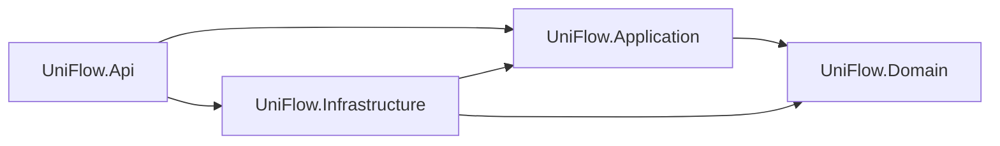

# Arquitectura de UniFlow

## Backend: Clean Architecture

La solución está en `api/UniFlow.sln`. Las referencias entre proyectos apuntan hacia las capas internas:



| Proyecto | Responsabilidad |
| --- | --- |
| `UniFlow.Domain` | Entidades y políticas del dominio, como las transiciones de pedidos y la liberación de capacidad. No referencia otros proyectos ni paquetes de infraestructura. |
| `UniFlow.Application` | Casos de uso de catálogo, pedidos, operación, administración y reportes; contratos de entrada; puertos para persistencia, identidad, imágenes y notificaciones. No depende de ASP.NET, EF Core ni Supabase. |
| `UniFlow.Infrastructure` | EF Core/Npgsql, repositorios, ejecución de consultas, transacciones y bloqueos PostgreSQL, migraciones, inicialización y adaptadores de Supabase Auth/Storage/JWKS. |
| `UniFlow.Api` | Composición de dependencias, autenticación HTTP, rutas, traducción de resultados a HTTP y adaptador SignalR. Los endpoints delegan los casos de uso. |

Los casos de uso devuelven resultados con un tipo de desenlace (`OutcomeKind`). La API decide los códigos HTTP, las cabeceras, los enlaces de recursos y la serialización. El usuario HTTP se abstrae mediante `ICurrentUser`; las conexiones SignalR pasan explícitamente la identidad autenticada de su contexto al caso de autorización de grupos.

La aplicación compone consultas mediante LINQ sobre los puertos de repositorio. `Infrastructure` es la única capa que conoce el proveedor asíncrono de EF, las cargas de agregados y el seguimiento de entidades. `ReadOnly()` expresa las consultas de lectura sin introducir dependencias de EF en Application. Los bloqueos de idempotencia, cupos y estados se expresan como operaciones del puerto de persistencia; su SQL está en Infrastructure y participa en la misma transacción.

Las cinco migraciones originales conservan sus identificadores y tablas. Se trasladaron a `UniFlow.Infrastructure/Persistence/Migrations`; esta separación no requiere recrear la base de datos. La fábrica de contexto para herramientas permite comprobar o generar migraciones sin ejecutar los inicializadores de la API.

```powershell
dotnet build api/UniFlow.sln
dotnet ef migrations has-pending-model-changes --project api/UniFlow.Infrastructure --startup-project api/UniFlow.Api
```

Para generar una migración nueva, utiliza esos mismos proyectos con `dotnet ef migrations add NombreDelCambio --project api/UniFlow.Infrastructure --startup-project api/UniFlow.Api --output-dir Persistence/Migrations`. La conexión de herramientas puede configurarse con `ConnectionStrings__Supabase`; la ejecución de la aplicación continúa usando su configuración habitual. Docker construye desde `api/` para incluir los cuatro proyectos.

## Frontend: ramas por funcionalidad

“Ramas” se implementa como una organización por funcionalidades dentro del código, no como ramas de Git. Cada rama tiene páginas independientes y su propio estado/acceso a datos:

```text
web/src/app/
  app.routes.ts                 Rutas y carga diferida de diez páginas
  layout/                       Cabecera, navegación, avisos y contenedor
  core/
    auth/                       Cliente Supabase Auth
    config/                     Configuración pública de ejecución
    connectivity/               Estado y eventos de conexión
    http/                       Cliente HTTP genérico e interceptor
    navigation/                 Correspondencia entre páginas y rutas
    state/                      Avisos y soporte de actualización de vistas
  shared/
    models/                     Contratos compartidos de catálogo y pedidos
    presentation/               Formatos COP, fechas y etiquetas de estado
  features/
    access/                     Sesión, guardas y acceso del personal
    catalog/                    Menú y tarjeta de producto
    ordering/                   Carrito, recogida, resumen y comprobante
    tracking/                   Seguimiento privado y conexión de su pedido
    staff-orders/               Cola, historial, detalle y conexión operativa
    catalog-admin/              Productos, categorías, disponibilidad y fotos
    operations-admin/           Horarios, excepciones, cupos, personal y reportes
```

Las páginas se cargan con `loadComponent`. Los stores de una rama conservan sus formularios, datos y operaciones; publican cambios para el renderizado de Angular sin zonas. `layout` coordina la navegación y presenta el estado compartido. Las tarjetas de producto, el resumen del carrito y el diálogo de detalle son componentes propios de sus ramas.

`core` y `shared` no importan funcionalidades. Una funcionalidad que necesita otra utiliza su entrada pública `index.ts`: pedidos consume el catálogo y la administración de catálogo consulta la sesión del personal. Las páginas del operador y el seguimiento administran sus propias suscripciones y consultas periódicas, en lugar de alojarlas en el componente raíz.

| Flujo | Ruta |
| --- | --- |
| Menú | `/` |
| Carrito y recogida | `/pedido`, `/recogida` |
| Seguimiento privado | `/seguimiento#token` |
| Acceso | `/personal/login` |
| Cola e historial | `/personal`, `/personal/history` |
| Catálogo y operación | `/personal/inventory`, `/personal/reports` |

Las rutas del personal tienen guardas; la autorización efectiva permanece en el servidor. Los enlaces existentes de seguimiento y paneles conservan sus rutas. El token del estudiante sigue en el fragmento y nunca forma parte de la URL enviada a la API.

## Comprobación de límites y regresiones

`npm --prefix verification run check:architecture` comprueba las referencias entre proyectos, las dependencias de las capas internas, la ausencia de persistencia en endpoints, las entradas públicas de las ramas y la carga diferida de páginas. Se ejecuta también antes de la suite de aceptación existente.

La [guía de verificación](verification/README.md) explica cómo levantar el entorno aislado en el puerto 8088 y ejecutar los 16 escenarios anteriores y dos regresiones de navegación con PostgreSQL, Auth y Storage reales. El proyecto Compose de pruebas es independiente del principal. El [informe de aceptación](verification/acceptance-report.md) y los [hashes de fuentes verificadas](verification/evidence.json) registran la ejecución correspondiente a esta arquitectura.
